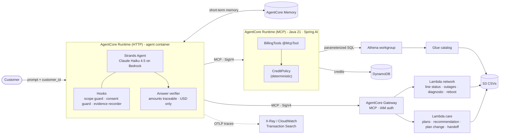

# Architecture

Coni is the customer-care agent of *Conecta*, a fictional telecom operator. It explains invoices, troubleshoots
home internet, recommends plans and issues credits.

The design rule is **the LLM proposes, deterministic code decides**. The model chooses which tools to call
and writes the answer. Every amount, every eligibility decision and every side effect is decided or checked by
plain code.

## Component map

## Components

| Component | Where it runs | Responsibility |
|---|---|---|
| Agent (`agent/`) | AgentCore Runtime, HTTP protocol, Python 3.12 arm64 container | Conversation loop, tool selection, answer writing. One session is bound to one authenticated customer. |
| Guards (`agent/conecta_agent/guards.py`) | Inside the agent, as Strands hooks | Cancel tool calls on another customer or without explicit consent; record tool results as evidence. |
| Verifier (`agent/conecta_agent/verifier.py`) | Inside the agent, after each turn | Rejects answers whose amounts are not in the evidence or that use a non-USD currency. One retry, then a safe fallback. |
| Billing MCP (`mcp-billing-java/`) | AgentCore Runtime, MCP protocol, Java 21 arm64 container | Customer profile, invoices, invoice comparison, credit eligibility and `apply_credit`. |
| CreditPolicy | Inside the billing MCP | Deterministic rules for what can be credited and how much (subtotal + 10% tax). |
| Gateway (`infra/gateway.tf`) | AgentCore Gateway | Exposes two Lambdas as one MCP server with inline tool schemas and IAM inbound auth. |
| Network / care tools (`tools/`) | Lambda, Python 3.12 arm64 | Line status, zone outages, remote diagnostic and reboot; plans, recommendation, plan change, handoff ticket. |
| Memory | AgentCore Memory (short-term, 30-day expiry) | Keeps the conversation of a customer session across turns and microVM restarts. |
| Data | S3 + Glue + Athena; DynamoDB for credits | Synthetic dataset for 198 customers and 3 months of billing. |

## Request lifecycle (one turn)

1. The client calls `InvokeAgentRuntime` with `{prompt, customer_id}` and a session id (33+ characters).
   AgentCore routes the session to its own microVM.
2. The agent loads the session (bound to that customer) and the memory, then runs the Strands loop.
3. For every tool call the **BeforeToolCall** hook checks scope and consent; it can cancel the call.
4. Allowed calls go over MCP (streamable HTTP, SigV4 signed) to the billing runtime or the Gateway.
5. The **AfterToolCall** hook stores the result text as evidence.
6. The final answer goes through the verifier. If it fails, the agent gets one internal instruction to rewrite;
   if it fails again, the customer gets a safe fallback and a handoff.
7. The response includes `answer`, `verified`, `verifier_retries`, `unsupported`, `guard_blocks`, `tool_calls`.

## Local vs AWS

The same code runs in both modes; only configuration changes.

| Concern | Local | AWS (us-east-1) |
|---|---|---|
| Agent | `python agent/cli.py C1001` | AgentCore Runtime (HTTP) |
| Billing MCP | `java -jar` on `:8000/mcp`, reads CSVs (`!aws` profile) | AgentCore Runtime (MCP), `aws` profile: Athena + DynamoDB |
| Network / care tools | FastMCP on `:8001/mcp` | Two Lambdas behind AgentCore Gateway |
| Credits | In memory, reset with `DELETE /local/credits` | DynamoDB `conecta-credits` |
| Memory | In process | AgentCore Memory |
| MCP auth | None | SigV4 (`MCP_AUTH=sigv4`) |
| Traces | None | ADOT → X-Ray → Transaction Search |

## Data model

Generated by `data/generate.py` (seed 42, dataset frozen on 2026-10-17, tax 10%).

| Table | Rows | Key fields |
|---|---|---|
| customers | 198 | customer_id, zone_id, plan_id, language |
| plans | 6 | plan_id, kind (mobile/home), monthly_fee, speed_mbps, roaming_included |
| invoices | 594 | invoice_id, period, due_date, status, paid_on |
| invoice_lines | 1,224 | line_id, invoice_id, concept_code (PLAN_FEE, ROAMING, PREMIUM_SMS, LATE_FEE, PRORATION, DATA_PACK, TAX), amount |
| usage_daily | 1,684 | data_mb, roaming_mb, roaming_country |
| devices | 108 | status (ONLINE/DEGRADED/OFFLINE), signal_dbm |
| zones, outages | 5 / 2 | outage status, cause, ETA |

Customers C1001 to C1008 carry hand-made cases (duplicate fee, roaming, outage, degraded modem, oversized plan,
premium SMS, legit late fee, proration). See the main [README](../README.md#seeded-cases).
