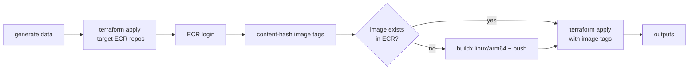

# Deployment

Everything is Terraform in `infra/`, region **us-east-1**, tagged `Project=conecta-care-agent`.

## Resources by file

| File | Resources |
|---|---|
| `data.tf` | S3 data bucket (CSVs) and Athena results bucket, public access blocked, 7-day lifecycle on results; Glue database `conecta` with 3 tables; Athena workgroup `conecta` (100 MB scan cutoff); DynamoDB `conecta-credits`. |
| `lambdas.tf` | Zip of `tools/`, Lambdas `network` and `care` (python3.12, arm64), execution role, log groups. |
| `gateway.tf` | AgentCore Gateway (MCP, `AWS_IAM` authorizer), one Lambda target per function with inline tool schemas, Gateway IAM role. |
| `runtimes.tf` | Two immutable ECR repos; billing runtime (MCP) with Athena/Glue/S3/DynamoDB permissions; AgentCore Memory; agent runtime (HTTP) with Bedrock, InvokeGateway, Memory and InvokeAgentRuntime permissions. |
| `observability.tf` | X-Ray trace destination = CloudWatch Logs and the log resource policy (Transaction Search). |
| `outputs.tf` | Runtime ARNs, Gateway URL, bucket and table names (not committed anywhere). |

## Deploy script

`scripts/deploy.sh` is idempotent:



Tags are a hash of the source, so an unchanged service is not rebuilt and the runtime is not updated. A second
run shows 0 changes.

## Observability

- The agent container runs `opentelemetry-instrument python app.py` (ADOT).
- Traces go OTLP/HTTP to `https://xray.us-east-1.amazonaws.com/v1/traces`, sampler `always_on`.
- Transaction Search stores spans in the `aws/spans` log group; they show in CloudWatch → GenAI Observability.
- Do not override `OTEL_RESOURCE_ATTRIBUTES`: AgentCore injects `aws.log.group.names` there.

## Operating it

```bash
./scripts/deploy.sh                                   # build + deploy
python scripts/invoke.py C1001 "¿Por qué mi factura está tan alta?" "Sí"
python evals/run_evals.py --remote                    # 12 scenarios against AgentCore
terraform -chdir=infra destroy                        # remove everything
```

## Cost

Idle cost is close to zero: Runtimes, Lambdas, Athena and DynamoDB (on demand) charge per use. The main costs
while testing are Bedrock tokens, Athena scans (capped at 100 MB per query) and CloudWatch logs.
